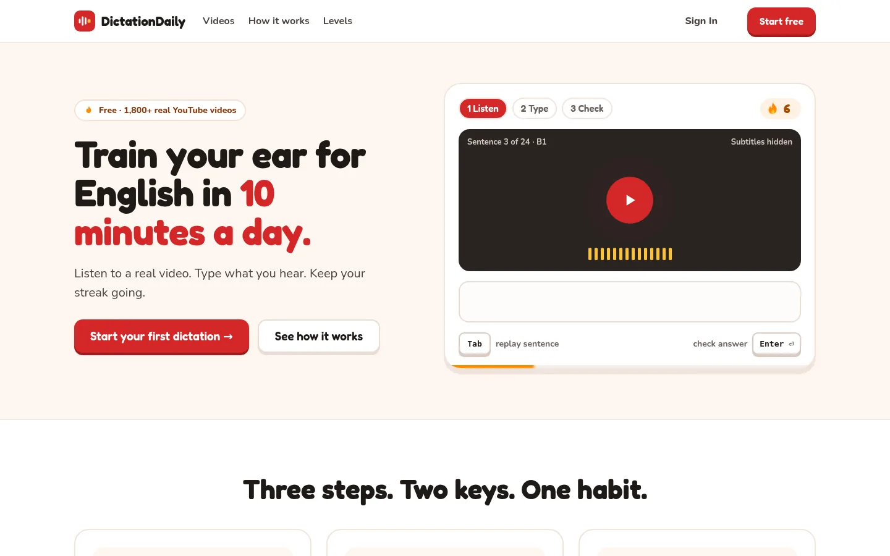
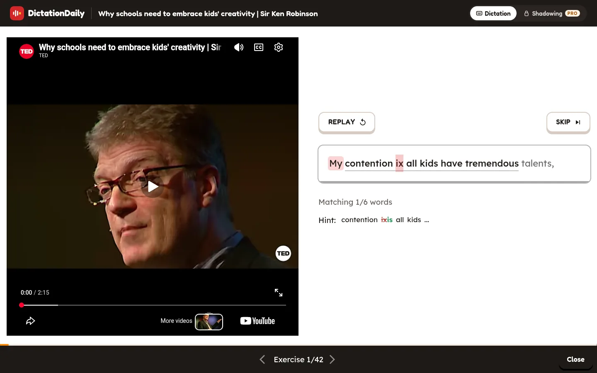
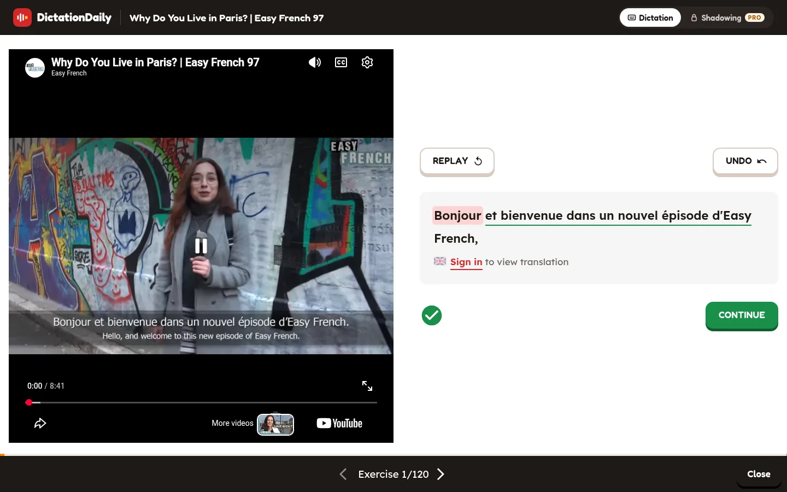

  

<h1 align="center">Dictation Daily</h1>

  Train your ear and your voice with real YouTube videos, one sentence at a time. 
  English, French, German, Italian, Spanish or Portuguese. Free, no ads, in the browser on your computer or phone.

  <a href="https://dictationdaily.com"><b>Open the app</b></a> ·
  <a href="https://docs.dictationdaily.com"><b>User guide</b></a> ·
  <a href="https://docs.dictationdaily.com/quick-start.html">Quick start</a> ·
  <a href="https://docs.dictationdaily.com/faq.html">FAQ</a>

## How it works

1. Pick the language you want to learn, then a video: by topic, level (B1 to C2), length or speed.
2. Press **START**. The first sentence plays.
3. **Dictation**: type what you heard and press `Enter`. The app marks each word: right, almost right, missing or extra. Fix it until the green tick appears, then press `Space` for the next sentence. `Tab` replays it.
4. **Shadowing** (Pro, the first 3 lines of every video free): say the sentence right after the speaker and see which words came through clearly.
5. Signed in, every sentence you finish shows its **translation** in your language, and you can **tap any word** to hear it, see what it means here and read its dictionary entry.

  

  

Sign in with Google and the app saves your progress, your learning time and a **daily streak**, so you can practise a little every day and pick up where you left off. You can practise without an account too.

## Where to find things

| | |
|---|---|
| **App** | https://dictationdaily.com |
| **User guide** | https://docs.dictationdaily.com (short, illustrated steps in simple English) |
| **Guide source** | [dictationdaily.github.io](https://github.com/DictationDaily/dictationdaily.github.io): the guide site, built with Tailwind CSS and published with GitHub Pages |
| **Lesson pipeline** | [dictationdaily-worker](https://github.com/DictationDaily/dictationdaily-worker) (what turns a video into a lesson on a pipeline computer) and [api.dictationdaily.com](https://github.com/DictationDaily/api.dictationdaily.com) (the task pool it pulls from) |

Found a mistake in a transcript, a translation or a word card? Every lesson has **Report a mistake** on the word card, or write to **support@dictationdaily.com** (see the [contact page](https://dictationdaily.com/contact)). What the app stores about you, and how to download or delete it, is on the [privacy page](https://dictationdaily.com/privacy) and your [Settings](https://dictationdaily.com/settings) page.

## Built with

Next.js on Cloudflare Workers (pre-rendered pages, D1, R2), Auth.js with Google sign-in, MUI, and YouTube for the videos. Lessons are made by the pipeline: yt-dlp, Whisper for the timing, the subtitles burned into Easy Languages videos read with Tesseract, a local LLM for levels and topics; translations and word cards come from a cloud model when a learner first needs them.
